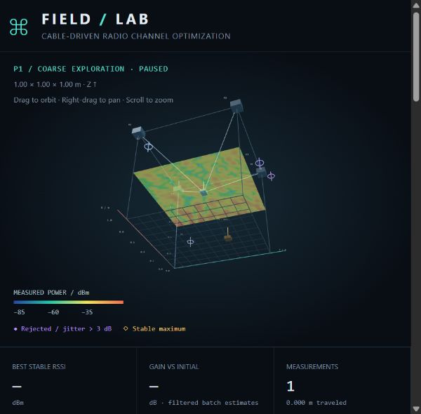

# FIELD / LAB — тросовый робот для поиска максимума RSSI

Интерактивная 3D-симуляция поиска положения приёмной антенны с наиболее сильным стабильным радиосигналом. Четыре троса перемещают приёмник RX внутри куба 1 × 1 × 1 м. Передатчик TX, отражения и четыре управляемых рассеивателя создают многолучевое поле.

Все измерения синтетические. Подключение к реальному роботу или радиоприёмнику не реализовано.

## Запуск

1. На странице репозитория нажмите **Code → Download ZIP** и распакуйте архив. Если репозиторий уже скачан через Git, используйте его локальную папку.
2. Откройте **index.html** в современном браузере с поддержкой WebGL.
3. Дождитесь появления куба, тросов и антенны. Для загрузки Three.js 0.170.0 и OrbitControls с jsDelivr нужен интернет.
4. Нажмите **▶ Старт**.

Установка пакетов, сборка и серверная часть не нужны. Приложение находится в одном HTML-файле, но не является офлайн-сборкой: библиотеки загружаются с CDN. На сайте GitHub файл index.html отображается как исходный код; для запуска откройте скачанный файл в браузере. Оформление и графики реализованы средствами CSS и Canvas.

Русский включён по умолчанию. Переключатель **RU / EN** в шапке сохраняет выбор в браузере. Переключение языка не сбрасывает измерения и не останавливает эксперимент.

## Первый эксперимент — пошагово

1. Выберите **Полёты Леви** в разделе «Фаза 1 / Исследование».
2. Выберите **Байесовская · GP / UCB** в разделе «Фаза 2 / Локальная оптимизация».
3. Установите режим **Только перемещение RX** и сценарий **Прямая видимость**.
4. Для знакомства выберите **Pluto AD9363 · MGC, шаг 0,25 дБ** и отключите **Импульсные помехи**. Меньший моделируемый шум позволит легче наблюдать стабильные точки.
5. Оставьте время затухания **300 мс** и скорость **3×**.
6. Нажмите **▶ Старт**. Наблюдайте переход от грубого поиска к точному, затем к микроуточнению.
7. После завершения робот вернётся в лучшую найденную стабильную точку. Посмотрите «Лучший стабильный RSSI» и «Прирост к начальному».
8. Нажмите **Скачать измерения · CSV ↓**, чтобы сохранить результаты.

Затем повторите запуск с **ESP32** и импульсными помехами: сравните квантование пакетов и количество отклонённых измерений. Смена приёмника, сценария, стратегии, оптимизатора или режима начинает новый эксперимент и очищает предыдущие результаты. Сначала экспортируйте нужные данные.

## Управление симуляцией

| Элемент | Действие |
| --- | --- |
| **▶ Старт / Ⅱ Пауза** | Запускает или замораживает модельное время. Продолжение сохраняет текущий этап измерения. |
| **Шаг →** | Выполняет одно измерение с движением, затуханием и сбором пакетов, затем ставит симуляцию на паузу. Если измерение уже начато, завершает его. |
| **Сброс** | Очищает результаты, возвращает RX в центр и восстанавливает начальные напряжения. Выбранные алгоритмы и сценарий сохраняются. |
| **Скорость симуляции** | Ускоряет модельное время от 1× до 10×, включая движение и сбор пакетов. |
| **Время затухания колебаний** | Задаёт ожидание между прибытием в точку и измерением. |

После завершённого поиска нажмите **Сброс**, чтобы начать новый запуск.

### Камера и отображение

- Перетаскивание левой кнопкой мыши — вращение камеры.
- Перетаскивание правой кнопкой — сдвиг камеры.
- Колесо — приближение и отдаление.
- **Срез истинного поля** — рассчитанная картина сигнала при текущих напряжениях и сценарии. Это подсказка наблюдателю, а не готовая карта для алгоритма поиска.
- **Ориентация среза** — плоскость XY, XZ или YZ; **Положение среза** сдвигает её по перпендикулярной оси.
- **Облако измеренных точек** — показывает или скрывает выполненные измерения.
- **Кинематика тросов** — показывает или скрывает тросы.

Координаты заданы в метрах, ось **Z направлена вверх**. Золотой маркер обозначает лучший стабильный результат, фиолетовые точки — отклонённые измерения с размахом более 3 дБ. Цвет остальных точек соответствует RSSI. Бирюзовая траектория — грубый поиск, синяя — точный, золотая — микроуточнение, розовая — настройка напряжений.

### Ручное управление

Раскройте **Ручное управление**. Ползунки **X, Y, Z** задают положение RX; **V1–V4** меняют напряжения рассеивателей от 0 до 3,3 В.

Каждое изменение ползунка останавливает поиск и очищает результаты, начиная новый эксперимент с изменённой конфигурацией. Для измерения в выбранной точке нажмите **Шаг →**. Ручное положение задаётся непосредственно, без плавного движения по траектории.

## Режимы оптимизации

| Режим | Что происходит |
| --- | --- |
| **Только перемещение RX** | Три фазы пространственного поиска при фиксированных напряжениях. |
| **Только настройка рассеивателей** | Начальное измерение, затем подбор напряжений при фиксированном положении RX. |
| **Совместно: RX + рассеиватели** | Пространственный поиск, затем подбор напряжений в найденной области. |

### Фаза 1 — грубое исследование

| Стратегия | Принцип |
| --- | --- |
| **Полёты Леви** | Короткие перемещения чередуются с редкими дальними переходами. |
| **3D-сетка «змейкой»** | Обход сетки 5 × 5 × 5 с шагом 22 см. |
| **Расширяющаяся 3D-спираль** | Исследование вокруг центра по расширяющейся траектории. |
| **Коррелированное случайное блуждание** | Случайные шаги с частичным сохранением предыдущего направления. |

Лимит — 40 измерений, для сетки — 125. Возможен досрочный переход по адаптивному порогу при наличии достаточно хороших стабильных результатов.

### Фаза 2 — точная оптимизация

| Оптимизатор | Принцип |
| --- | --- |
| **Байесовская · GP / UCB** | Гауссовский процесс с RBF-ядром оценивает сигнал и неопределённость; UCB выбирает перспективные точки. Перемещение за шаг ограничено 5 см. |
| **Имитация отжига** | Случайные локальные пробы; вероятность принятия ухудшения уменьшается по мере охлаждения. |
| **Рой частиц · последовательный опрос** | Шесть частиц обновляют положения по собственным и общим лучшим результатам. Робот измеряет их последовательно. |
| **Градиентный поиск · базовый** | Пробы вдоль координатных осей с шагом 4 см около лучшей локальной точки. |

Фаза выполняет 42 измерения. Байесовская модель использует стабильные измерения этой фазы и разложение Холецкого для расчёта прогноза.

### Фаза 3 — микроуточнение

Вокруг лучшей точки проверяется крест из 25 точек: центр и смещения по трём осям с шагом 5 мм, до 2 см в каждую сторону. В каждой точке собираются 20 пакетов. Нестабильные серии не обновляют лучший стабильный результат.

### Настройка напряжений и завершение

При настройке рассеивателей последовательно проверяются восемь уровней напряжения для каждого из четырёх рассеивателей — всего 32 измерения. Выигрыш рассчитывается по модели и не гарантирован.

В конце восстанавливаются координаты **и напряжения**, соответствующие лучшему стабильному измерению за эксперимент. Если все серии отклонены, приложение сообщает, что стабильная точка не найдена.

## Как читать телеметрию

RSSI измеряется в дБм: **−40 дБм — более сильный сигнал, чем −70 дБм**.

| Показатель | Значение |
| --- | --- |
| **Исходный пакет** | Последнее измерение с шумом и квантованием: шаг 1 дБ у ESP32 или 0,25 дБ у Pluto SDR. |
| **Среднее / медиана пакетов** | Статистики серии из 20 пакетов. |
| **Оценка Калмана** | Сглаженная оценка с предварительной медианной обработкой. Может быть дробной при целочисленных исходных пакетах. |
| **Размах / проверка** | Максимум минус минимум исходных значений серии. До 3 дБ включительно — стабильно; выше — отклонено. |
| **Лучший стабильный RSSI** | Максимальная оценка среди серий, прошедших проверку стабильности. |
| **Прирост к начальному** | Разница между лучшим стабильным результатом и первой фильтрованной оценкой. Первая серия служит базой даже при её отклонении. |
| **Измерения** | Число завершённых серий, включая отклонённые. |
| **Трос L1–L4** | Расстояния от каретки до верхних креплений, в миллиметрах. |

График **Поток пакетов** сравнивает исходные данные и оценку Калмана. График **Стабильный максимум / сходимость** показывает лучший стабильный результат, отклонённые точки и отметки смены фаз. Журнал фиксирует переходы, отклонения и завершение поиска.

При совместной оптимизации старые точки облака относятся к напряжениям на момент измерения, а срез истинного поля — к текущим напряжениям. Поэтому их значения могут различаться.

## Экспорт измерений

Кнопка **Скачать измерения · CSV ↓** сохраняет файл `field-lab-measurements.csv`. Одна строка соответствует одной завершённой серии из 20 пакетов.

| Столбцы | Содержимое |
| --- | --- |
| `step`, `phase` | Номер измерения и фазы; фаза 4 — настройка напряжений. |
| `x_m`, `y_m`, `z_m` | Координаты RX в метрах. |
| `kalman_dbm`, `mean_dbm`, `median_dbm` | Оценка Калмана, среднее и медиана в дБм. |
| `jitter_db`, `stable` | Размах в дБ и результат проверки (`true` / `false`). |
| `v1`–`v4` | Напряжения рассеивателей в вольтах. |
| `raw_packets_dbm` | Все 20 исходных значений через точку с запятой внутри одной ячейки. |

Заголовки CSV остаются английскими для совместимости с программами анализа. При импорте в электронную таблицу укажите разделитель столбцов **запятая**, десятичный разделитель **точка** и кодировку **UTF-8**.

Сохраняйте CSV перед сбросом или перезагрузкой страницы: история эксперимента между запусками страницы не сохраняется.

## Частые вопросы

- **Вместо сцены пустое поле.** Проверьте интернет, доступность jsDelivr и поддержку WebGL в браузере, затем обновите страницу.
- **Много фиолетовых точек, максимума нет.** Порог 3 дБ применяется к исходным пакетам. Даже гауссов шум ESP32 с σ = 1,5 дБ может его превысить. Попробуйте Pluto SDR и отключите импульсные помехи. Смена датчика очистит результаты.
- **Робот стоит после запуска.** Возможны затухание колебаний, сбор пакетов или настройка напряжений без движения. Проверьте статус над сценой.
- **После завершения «Старт» не запускает поиск.** Нажмите «Сброс» для нового эксперимента.
- **На узком экране не видно телеметрию.** Прокрутите вниз: панели перестраиваются под ширину окна.
- **Максимум не совпадает с яркой областью среза.** Срез показывает одну плоскость; поиск ограничен числом измерений и проверкой стабильности. Глобальный максимум не гарантируется.

## Модель и ограничения

Радиоканал складывает комплексные поля прямого луча, шести отражений от мнимых источников и четырёх рассеивателей. Длина волны — 0,121 м, частота — 2472 МГц, канал Wi-Fi 13. MCS0 обозначает сценарий; полноценный тракт модуляции и декодирования Wi-Fi не моделируется.

В сценарии без прямой видимости ослабляется весь прямой луч; геометрическая проверка перекрытия луча преградой не выполняется. Зависимость фазы рассеивателя от напряжения линейная и идеализированная. Пакеты принимаются с частотой 200 Гц модельного времени.

Длины тросов рассчитываются как евклидовы расстояния до креплений. Колебания каретки показаны затухающей анимацией. Натяжение, ограничения ускорения и столкновения не рассчитываются; остановочные колебания не являются полноценной механической моделью радиоканала.

Это иллюстративная симуляция, а не откалиброванный электромагнитный или механический расчёт. Поиск может пропустить узкие пики многолучевого поля. Результат — лучший стабильный **измеренный** сигнал, без доказательства глобальной оптимальности и гарантии прироста +3–6 дБ.

## Проверки реализации

Проверка синтаксиса JavaScript выполнена. Тестовый запуск в Node с имитацией объектов визуализации проверил 96 сочетаний четырёх стратегий исследования, четырёх оптимизаторов, двух датчиков и трёх режимов. Проверялись завершение поиска, границы координат, размер серии, квантование, отбраковка и возврат к лучшему стабильному результату. В 91 сочетании найдены стабильные результаты; в пяти корректно сообщено об их отсутствии.

В браузере проверены отображение 3D-сцены, одиночное измерение, переключение RU / EN и сохранение языка. Длительный замер стабильных 60 FPS не проводился: производительность зависит от видеокарты, браузера и размеров окна.
